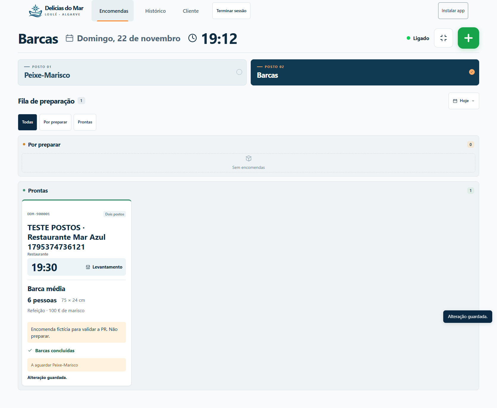
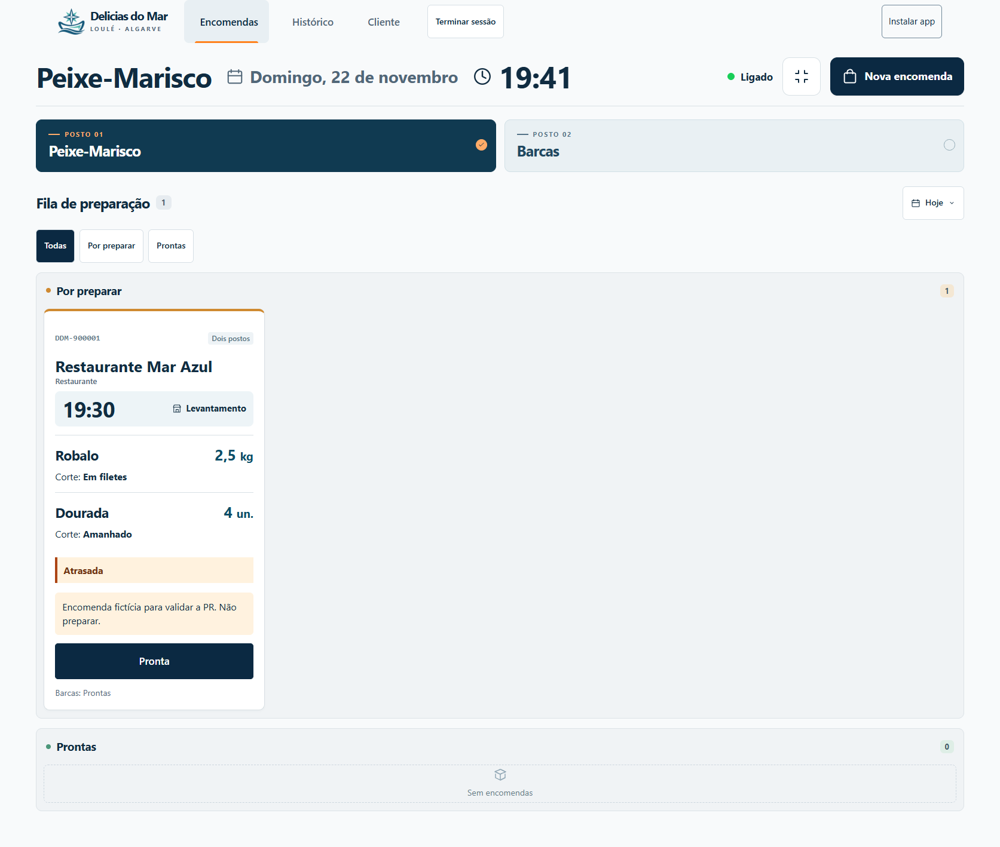

# Delicias do Mar · Encomendas

Aplicação de encomendas para o **Posto 1 · Peixe-Marisco** e o **Posto 2 · Barcas**. A base partilhada atual continua a ser de demonstração.

## Alterar a app

| Ficheiro | Função |
| --- | --- |
| `src/estilo.css` | Cores, tipografia, espaçamento, cartões e adaptação a telemóvel |
| `src/index.html` | Estrutura da página, navegação e logótipo |
| `src/app.js` | Conteúdo dos painéis, formulários, etapas de preparação e ligação à base de dados |
| `src/install.js`, `src/app.webmanifest` | Instalação, ícones e atalhos dos postos |
| `service-worker.template.js` | Reabertura da app e cache dos ficheiros da interface |

O posto das Barcas recolhe e coze o seu próprio marisco. O posto Peixe-Marisco trata do peixe, do marisco vendido em separado e dos congelados. As encomendas de demonstração ficam na base de dados partilhada. As pré-visualizações usam essa mesma base. Usa encomendas fictícias quando experimentares alterações.

## Ligar ao Cloudflare uma vez

1. Cria um repositório privado no GitHub. Extrai o pacote e coloca o seu conteúdo na raiz do repositório. A pasta `src`, o ficheiro `wrangler.jsonc` e o ficheiro `build.mjs` ficam ao mesmo nível.
2. No Cloudflare, abre **Workers & Pages → ddm-encomendas → Settings → Builds → Connect**. Escolhe o repositório e define `main` como ramo de produção.
3. Usa a raiz do repositório, deixa vazio o campo **Build command** do painel e mantém **Deploy command** como `npx wrangler deploy`. O Wrangler executa a preparação definida em `wrangler.jsonc`. Para veres mudanças antes de as publicar, ativa os builds dos outros ramos com `npx wrangler preview`. O bloco `previews` no ficheiro de configuração permite gerar essas pré-visualizações sem publicar na produção.
4. Guarda uma alteração no repositório após a ligação e acompanha o resultado em **Deployments**. Confirma a abertura dos dois postos e o indicador **Ligado**.

## Testar uma mudança

Cria um ramo para a alteração e abre um pull request. Abre a pré-visualização no PC da loja e no telemóvel. Junta a alteração a `main` depois de a aprovares.

Para gerar a pasta publicável localmente, usa Node.js 22.12 ou superior e executa `node build.mjs`. Os ficheiros para editar ficam em `src`. Cada alteração ao conteúdo gera uma nova versão da cache da app.

## Modo posto tátil

Seleciona **Peixe-Marisco** ou **Barcas** e ativa o botão **Modo posto** no cabeçalho. O posto e o modo ficam guardados neste navegador/dispositivo, incluindo ao reabrir a app pelo endereço inicial. Os atalhos específicos da app escolhem e guardam o posto indicado. Sair do ecrã inteiro do navegador mantém o modo posto; o botão da app permite sair desse modo. Num dispositivo novo, abre o Posto 1 · Peixe-Marisco. O identificador interno `bancada` mantém os atalhos e preferências existentes compatíveis.

O topo mostra o posto, data de hoje, relógio de Lisboa, ligação, ecrã inteiro e Nova encomenda. A navegação **Preparação · Encomendas · Cliente** permanece disponível também em modo posto. A data do cabeçalho é a data atual; o seletor **Dia das encomendas** continua a controlar o dia da fila. O selo Modo demo foi retirado, sem alterar a base de dados ou o funcionamento de Nova encomenda.

Próxima fase acordada: questionário de barca em Cliente e circuito **Aceitar · Contactar · Recusar** apenas para pedidos de clientes/website, antes da preparação. A integração com `ddm-website` e a alteração de Nova encomenda ficam para essa fase. Esta revisão não altera a base de dados.

Nas Barcas, os cartões permitem iniciar, registar recolha, confirmar cozedura feita ou dispensada, registar montagem e concluir. O marisco da barca pertence sempre às Barcas. Em Peixe-Marisco, cada produto tem a sua quantidade, unidade e corte; concluir a preparação confirma todos os produtos desse posto. Uma encomenda mista só disponibiliza **Registar entrega** depois de ambos os postos estarem prontos.

As ações ficam bloqueadas durante a gravação ou sem ligação. A confirmação **Alteração guardada** só aparece após a resposta da base e a leitura do estado guardado. Se houver erro, a app atualiza a encomenda e pede para confirmar o estado antes de repetir.

## Testes dos dois postos

Com Node.js 22.12+ e npm:

```sh
npm install
npx playwright install chromium
npm run build
npm test
```

O teste usa duas sessões de navegador com armazenamento independente e uma API simulada partilhada. Cobre a encomenda mista, unidades por artigo, etapas das Barcas (cozedura feita e dispensada), bloqueio da entrega, toques repetidos, erro de gravação, perda/recuperação de ligação, reabertura por dispositivo e alvos táteis de pelo menos 56 px. `DDM_BROWSER=chrome` permite usar o Chrome instalado; `msedge` usa o Edge.

Os testes não alteram `docs/`. Para refazer as imagens dos postos, junta `--update-images` (por exemplo `node tests/postos.cjs --update-images`).

`npm run test:live` repete o percurso essencial na base de demonstração: **cria uma encomenda fictícia identificada como TESTE POSTOS**, conclui os dois postos e regista a entrega para a retirar da fila. Não executar contra uma base de produção. As duas sessões só partilham os dados do servidor, nunca o armazenamento local.

Evidência de 21/11/2026: teste real concluído com `DM-1121-113`. A barca terminou com a Bancada ainda por iniciar; a entrega só ficou disponível depois da conclusão da Bancada; as duas sessões reabriram no posto e modo guardados. A encomenda fictícia foi marcada como entregue. As imagens mostram essa mesma encomenda durante a preparação:

| Barcas | Bancada |
| --- | --- |
|  |  |
